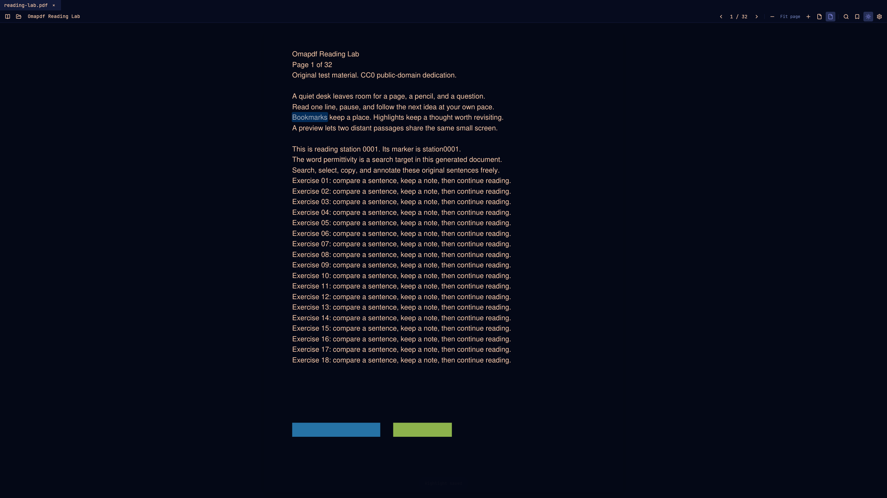

# Omapdf

[](https://github.com/qwlp/omapdf/actions/workflows/build.yml)

A native Wayland PDF and EPUB reader for Linux, built in Rust with GPUI and MuPDF.
Keyboard navigation, smooth scrolling, research tools and an interface that follows
your Omarchy theme.



## Install

**Arch Linux (AUR):**

```sh
yay -S omapdf-bin
```

This installs the reader, desktop entry and icons. No build step or FUSE is
required. Any other AUR helper works too.

**Any other Linux:** download the portable executable for your architecture
from [GitHub Releases](https://github.com/qwlp/omapdf/releases) —
`omapdf-linux-x86_64` or `omapdf-linux-aarch64` — then:

```sh
chmod +x omapdf-linux-x86_64
./omapdf-linux-x86_64 paper.pdf
```

AppImages such as `Omapdf-0.0.1-alpha-x86_64.AppImage` are also available.
Mark the file executable and launch it; if FUSE is unavailable, run it with
`--appimage-extract-and-run`. SHA-256 checksum files accompany every download.
The current release is **0.0.1-alpha**.

Both forms run on any Linux Wayland desktop and use your host GPU drivers.
To make Omapdf your default PDF reader afterward:

```sh
xdg-mime default io.omapdf.desktop application/pdf
```

## Why I’m making this

I started Omapdf after getting frustrated with Sioyek as my default PDF reader
on Omarchy. I liked its reading and research tools, but wanted smooth scrolling,
a simpler interface and settings that were easier to use.

Omapdf runs directly on Wayland, follows my Omarchy theme and font, and handles
both papers and books. Document processing is built in, so there are no Poppler
or Calibre commands to install.

## Features

### Reading

- PDF and EPUB support through the bundled native MuPDF engine.
- Single-page, two-page spread, continuous horizontal and continuous vertical layouts.
- Smooth keyboard and mouse-wheel scrolling, adjustable response and wheel speed,
  and direct trackpad scrolling.
- Cursor-anchored zoom, fit to width, fit to height and whole-page fit.
- Tabs or separate windows, recent documents, file chooser, typed paths and drag/drop.
- Fullscreen reading, dark mode and saved reading positions, zoom and offsets.
- Collapsible, searchable table of contents and chapter navigation.
- Internal links, external web/email links, local/global marks and back/forward history.
- A text-line reading ruler with keyboard movement across pages and optional
  line-by-line wheel scrolling.
- Password-protected PDFs with a masked unlock prompt. Passwords stay in the running
  session; exported annotated PDFs retain source encryption.

### Search and research

- Live document search with case-sensitive, whole-word and regular-expression options.
- Search-result snippets, page labels, match overlays and next/previous navigation.
- Background PDF text indexing so you can start reading large documents first.
- Inline page previews and portals linking locations within or between documents.
- A separate portal helper window for keeping a reference visible while reading.
- Searchable command palette, descriptions, fuzzy completion, argument hints and
  session command history.
- Numeric navigation prefixes, configurable key sequences and command sequences.

### Selection and annotations

- Text selection and copying, including selections spanning visible pages.
- Bookmarks, 26 configurable highlight colors, underline and strikeout types.
- Comments on highlights, annotation lists and navigation between annotations.
- Cross-page highlights grouped for comment editing, navigation, export and deletion.
- Import PDF highlights, underline, strikeout and text/free-text notes into the library.
- Export annotations to a new PDF while preserving the source document and its
  existing embedded annotations.
- Rectangle selection across visible pages, native PNG clipboard copying and PNG export.
- JSON library backups and read-only migration from legacy JSON or combined/split
  SQLite libraries. Import reports retain unresolved records for later retry.

### EPUB books

- Native pagination with chapter structure, images, code and basic publisher styling.
- Adjustable text size, line spacing, page width and page height.
- Background reflow with text anchors that relocate reading positions, bookmarks,
  marks and matching highlights.
- The same search, annotations, layouts and reading history used for PDFs.

### Desktop and appearance

- Native Wayland windows and GPU rendering through GPUI.
- Live Omarchy palette and system monospace font integration, with built-in fallbacks.
- Optional document colors that follow Omarchy’s paper and ink colors while
  preserving embedded images and colored figures.
- Compact icon toolbar, tooltips, rounded-corner preference and optional UI animations.
- Searchable settings, editable preference/keybinding files and live configuration reload.
- Automatic document reload that tolerates partial writes and atomic file replacement,
  while retaining your reading position and library annotations.
- A portable executable bundling the reader, document engine, fonts and user-space runtime.

Outstanding features and behavioral gaps are tracked as TODOs in the
[roadmap](docs/ROADMAP.md). The list above describes implemented functionality;
Omapdf is still under active development.

## Build and run

You need a Rust toolchain, a C/C++ build toolchain for the bundled native dependencies,
`pkg-config`, and the development libraries needed by GPUI’s Linux Wayland backend.
The build targets Linux x86-64 and ARM64. Portable packages are built natively
on each architecture.

```sh
cargo build --release --locked
./target/release/omapdf paper.pdf
./target/release/omapdf book.epub
```

Build the portable executable after building the release reader:

```sh
python3 scripts/build_portable.py
./dist/omapdf paper.pdf
```

Or use `make portable` to run both steps. Portable packaging uses `ldd` and
`readelf` to collect the local user-space runtime. On first launch, the executable
extracts a private, versioned runtime under `$XDG_CACHE_HOME/omapdf/runtime`.
The host supplies the Wayland compositor, GPU drivers and desktop portals.

To install the portable build and desktop entry for your user:

```sh
make install PREFIX="$HOME/.local"
```

Then choose Omapdf as your PDF reader in your desktop’s application settings, or:

```sh
xdg-mime default io.omapdf.desktop application/pdf
```

## Keyboard essentials

| Key | Action |
| --- | --- |
| `j` / `k`, arrows | Scroll |
| `Space` / `Shift+Space` | Move half a screen |
| `gg` / `G` | First / last page |
| `Ctrl+PageDown` / `Ctrl+PageUp` | Next / previous page |
| `+` / `-` | Zoom |
| `w` / `f` | Fit width / whole page |
| `L` | Cycle layouts |
| `t` | Contents |
| `/` or `Ctrl+f` | Search |
| `n` / `N` | Next / previous match |
| `b` / `B` | Add / list bookmarks |
| `h` / `H` | Add / list highlights |
| `p` / `gp` | Set portal endpoints / follow portal |
| `Backspace` | Previous location |
| `Ctrl+o` / `o` | File chooser / enter a path |
| `O` | Recent documents |
| `:` / `Ctrl+p` | Command prompt / palette |
| `Ctrl+,` | Settings |
| `F7` / `F8` / `F11` | Visual scrolling / dark mode / fullscreen |
| `?` | Help |

See [default keybindings](assets/keys.config) and the
[command reference](docs/COMMANDS.md) for more actions.

## Configuration and library

Omapdf uses the XDG directories:

| Contents | Default location |
| --- | --- |
| Configuration | `~/.config/omapdf/` |
| Reading history and annotations | `~/.local/share/omapdf/library.json` |
| Portable runtime | `~/.cache/omapdf/runtime/` |

Preferences load from `prefs.config`, then `prefs_user.config`; keybindings load
from `keys.config`, then `keys_user.config`. These files are optional. Settings
writes preserve comments and unrelated preferences. Valid edits apply live;
invalid edits keep the previous working configuration.

```text
# prefs_user.config
page_layout vertical
smooth_scroll 1
wheel_scroll_multiplier 2.0
document_theme 1
epub_font_size 14
highlight_color_a 0.94 0.64 1.0
```

```text
# keys_user.config
next_page J
previous_page K
execute_command <C-p>
```

See [default preferences](assets/prefs.config) for supported names and values.
Booleans use `0` or `1`; colors use three RGB values between `0` and `1`.
Library saves are atomic. Importing a library backs up the current library before
merging; source databases are opened read-only.

Useful commands:

```text
:enter_visual_mark_mode
:import /path/to/library.json
:import_sqlite /path/to/database-directory
:import_report
:retry_imports
:export /path/to/backup.json
:import_annotations
:embed_annotations /path/to/annotated-copy.pdf
:copy_image
:export_image /path/to/selection.png
```

## Command line

```sh
omapdf paper.pdf --page 12
omapdf first.pdf second.pdf
omapdf paper.pdf --execute-command 'search compiler'
omapdf --inspect book.epub
omapdf --config /path/to/settings --library /path/to/library.json paper.pdf
```

`--execute-command` is repeatable. Additional launches forward requests to the
running instance for that library. Separate library files allow isolated sessions.

## Continuous integration

[GitHub Actions](https://github.com/qwlp/omapdf/actions/workflows/build.yml) runs
formatting, Clippy, native tests, release builds and portable CLI checks on Linux
x86-64 and ARM64. Every successful build uploads portable executables, AppImages and checksums as
workflow artifacts. Version tags publish both architectures to GitHub Releases;
tags containing a suffix such as `-alpha` produce prereleases.

Desktop interaction smoke tests run separately on a real Wayland/Hyprland session.

## Development

```sh
cargo fmt --all --check
cargo clippy --locked --all-targets -- -D warnings
cargo test --locked
```

Wayland smoke scripts in `scripts/` exercise real interactions using isolated
settings and libraries. They require Hyprland; screenshot/input checks also use
local desktop tools. For example:

```sh
python3 scripts/settings_smoke.py paper.pdf --binary target/release/omapdf
python3 scripts/reload_smoke.py --binary dist/omapdf --no-tools
python3 scripts/epub_smoke.py examples/reading-lab.epub --binary dist/omapdf --no-tools
```

Command descriptions live in `assets/command_docs.json`. Run
`python3 scripts/command_inventory.py` after changing the dispatcher or descriptions.
See [implementation notes](docs/PORTING.md), [validation](docs/VALIDATION.md) and
[the roadmap](docs/ROADMAP.md).

## License and credits

Project source is licensed GPL-3.0-or-later. MuPDF uses AGPL-3.0; distributions of
the combined executable must meet the applicable license requirements. GPUI,
fonts, icons and bundled libraries retain their own licenses and attribution.
See [LICENSE](LICENSE) and [third-party notices](THIRD_PARTY.md).

## Example documents

The documents in [examples/](examples/) contain original text and generated
geometric graphics, dedicated to the public domain under **CC0-1.0**. No commercial
books or downloaded publications are bundled. They cover PDF reading, nested
contents, image-only pages, EPUB reflow and a 1,220-page indexing workload.

Regenerate them with `python3 scripts/generate_examples.py`. See the
[fixture dedication](examples/LICENSE) and [fixture guide](examples/README.md).
